# PRG32
<p align="center">
  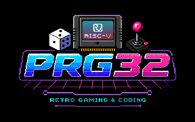
</p>
PRG32 is an open-source educational runtime for teaching RISC-V assembly and C programming in undergraduate computer architecture and systems courses. PRG32 exposes a minimal interface built around the init/update/draw game loop.

PRG32 provides an entire retro-gaming environment to run native RV32IMAC machine code on the Espressif ESP32-C6, a commercially available microcontroller. The platform includes embedded firmware, a .prg32 cartridge format and toolchain, a QEMU-based desktop emulator and can be used in combination with the Cartridge Store, a server providing app-store-style distribution, multiplayer relay, score tracking, and frame-level metrics collection.

Cartridges reach a running console without Wi-Fi or a bootloader reset: the
resident firmware recognizes the framed `prg32-io-1.0` protocol on the board's
native USB port, shows upload progress, verifies the cartridge, and can start
it. The same protocol serves the SDK command line, QEMU, PRG32-QT, and web
applications such as the PRG32-Construction-Kit through the browser's Web
Serial API.

PRG32 is **not** a CPU instruction emulator. Code runs natively on ESP32-C6 hardware, or on Espressif QEMU firmware target ESP32-C3 for desktop graphics/testing.

> [!TIP]
> **Ready to go, nothing to install:** open the hosted
> [PRG32 Construction Kit at kit.prg32.uniparthenope.it](https://kit.prg32.uniparthenope.it)
> in a Chromium-based browser. Write a game with Blocks, C, RISC-V assembly, or
> PRG32 Python, build a real `.prg32` cartridge, play it in the simulator, and
> send it to a PRG32 board over USB.

## Featured Games

Cartridges made with PRG32, each in its own repository and available from the
[Cartridge Store](https://store.prg32.uniparthenope.it/). Screenshots are the
store captures of the 320x200 game area.

<table>
  <tr>
    <td align="center"><a href="https://github.com/riscv-prg32/Azzurra-s-Pro-Tennis-Challenge">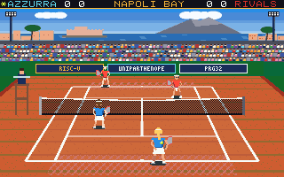</a><br><b>Azzurra's Pro Tennis Challenge</b></td>
    <td align="center"><a href="https://github.com/riscv-prg32/Outbun-napoli97">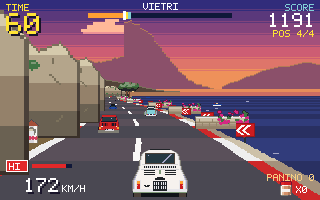</a><br><b>Outbun Napoli 97</b></td>
    <td align="center"><a href="https://github.com/riscv-prg32/SensationalSoccer">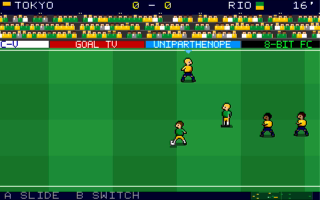</a><br><b>Sensational Soccer</b></td>
  </tr>
  <tr>
    <td align="center"><a href="https://github.com/riscv-prg32/TheTrerroteConnection">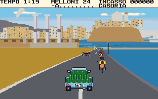</a><br><b>The Trerrote Connection</b></td>
    <td align="center"><a href="https://github.com/riscv-prg32/EntomoTheParallelogramForce-napoli2010">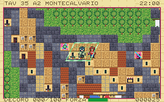</a><br><b>Entomo: The Parallelogram Force</b></td>
    <td align="center"><a href="https://github.com/riscv-prg32/Galleria2007">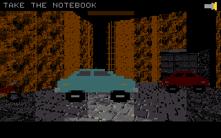</a><br><b>Galleria 2007</b></td>
  </tr>
  <tr>
    <td align="center"><a href="https://github.com/riscv-prg32/Drumfight-napoli97">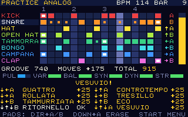</a><br><b>Drumfight Napoli 97</b></td>
    <td align="center"><a href="https://github.com/riscv-prg32/YouHaveGotPizza-DeluxeEdition">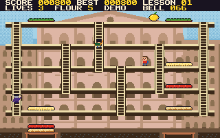</a><br><b>You Have Got Pizza: Deluxe Edition</b></td>
    <td align="center"><a href="https://github.com/riscv-prg32/spiriti-napoli97">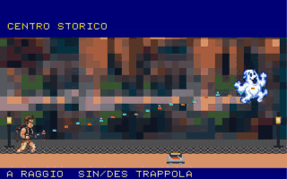</a><br><b>Spiriti Napoli 97</b></td>
  </tr>
</table>

The in-tree cartridges ([Blackjack](cartridges/blackjack/README.md),
[Poing](cartridges/poing/README.md), [Bach demo](cartridges/bachdemo/README.md),
[DeviceDemo](cartridges/devicedemo/README.md)) are described in
[Cartridges](docs/software/cartridges.md).

## The PRG32 Ecosystem

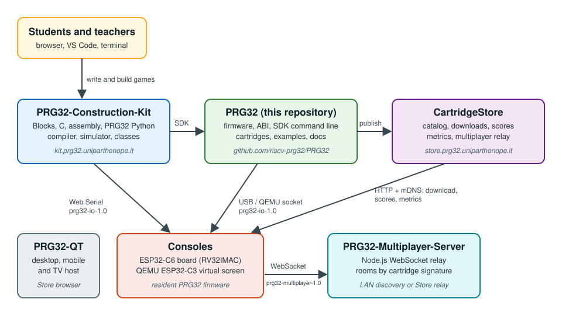

| Repository | Description |
|---|---|
| [PRG32-Construction-Kit](https://github.com/riscv-prg32/PRG32-Construction-Kit) | Classroom web IDE: Blocks, C, RISC-V assembly, and PRG32 Python projects compiled into real `.prg32` cartridges, a browser simulator, Web Serial deployment to a board, and teacher class views. Hosted at [kit.prg32.uniparthenope.it](https://kit.prg32.uniparthenope.it). |
| [CartridgeStore](https://github.com/riscv-prg32/CartridgeStore) | App-store-style catalog and classroom service hub: cartridge downloads per architecture, scores, frame metrics, a multiplayer relay, and mDNS discovery for the firmware setup menu. Public instance at [store.prg32.uniparthenope.it](https://store.prg32.uniparthenope.it/). |
| [PRG32-Multiplayer-Server](https://github.com/riscv-prg32/PRG32-Multiplayer-Server) | Small Node.js WebSocket relay for multiplayer cartridges: groups consoles by cartridge signature and relays bounded player snapshots with the `prg32-multiplayer-1.0` protocol. |
| [PRG32-QT](https://github.com/riscv-prg32/PRG32-QT) | Portable Qt 6 host that runs `.prg32` cartridges on desktop, mobile, and TV systems through the same ABI. |

See [The PRG32 Ecosystem](docs/ecosystem.md) for the protocols between the parts.

### Hardware

The platform is designed around the **Espressif ESP32-C6** microcontroller and uses accessible, low-cost components for easy classroom assembly. The standard hardware setup includes:
- **Display**: A 2.8" SPI ILI9341 TFT display. PRG32 uses the classic retro-game resolution of 320x200 with a 256-entry RGB565 palette.
- **Audio**: One or two MAX98357A I2S amplifiers for mono or stereo sound.
- **Input**: A simple digital joystick and action buttons wired directly to GPIO pins. GPIO12 and GPIO13 stay free for the native USB connector used for offline cartridge uploads.

Please refer to the [Hardware & Pinouts](docs/hardware/hardware.md) guide for further information about breadboard wiring diagrams, PCB references and the full bill of materials.

### Hardware Availability

You can build a PRG32 console from the
[bill of materials](docs/hardware/where_to_buy.md) or fabricate the open
[PCB reference design](docs/hardware/pcb/README.md). Some third-party boards may
also fit the PRG32 specification, for example the
[MAYPAD](https://madaboutyou.it/maker32/maypad/) ESP32-C6 board sold by Mad About
You - MAY SRL. The list, what each seller states, and what has been verified are
in [Hardware Availability](docs/hardware/availability.md).

> [!IMPORTANT]
> **No agreement, no affiliation.** PRG32 is a public, open-source,
> open-hardware, non-profit research prototype project. There is **no agreement,
> partnership, sponsorship, or connection of any kind** between the University
> of Naples "Parthenope" and the companies that provide hardware which could fit
> the PRG32 specifications. Products are mentioned only for convenience; they are
> not endorsed, certified, or tested by the University or the PRG32 maintainers.

## Academic Profile

- Project domain: Embedded Systems and Computer Architecture Education
- Platform focus: ESP32-C6 (hardware) and ESP32-C3 QEMU path (desktop emulation)
- Course style: first-year/early undergraduate assembly and systems labs
- Academic supervisor / project lead: Raffaele Montella - UniParthenope - Associate Professor of Computer Science, head of the High-Performance Scientific Computing Laboratory (HPSC Lab)
- Contributor (student): Simone Boscaglia - UniParthenope - BSC in Computer Science student
- Contributor (student): Ivan Cafiero - UniParthenope - BSC in Computer Science student
- Contributor (student): Dario Caramiello - UniParthenope - MSC in Computer Science student
- Contributor: Giuseppe Coviello - bounded random-number ABI and examples

## Install & Setup

<details>
<summary><strong>Windows</strong></summary>

1. Install Git for Windows and Python 3.
2. Download and run the Espressif ESP-IDF Tools Installer for Windows.
3. Select an ESP-IDF 5.4 or newer release.
4. Include support for `esp32c3` and `esp32c6`.
5. (Optional) Check the QEMU RISC-V emulator box during installation if you want to use the QEMU desktop emulator.
6. Open the "ESP-IDF PowerShell" shortcut created by the installer. This will activate the ESP-IDF environment, so `pip` will install into it.
7. Clone the project and verify your setup from that shell

```powershell
cd $HOME\Documents
git clone https://github.com/riscv-prg32/PRG32
cd PRG32
pip install pyaudio zeroconf
python -m prg32 doctor
```

#### Notes
- Use the ESP-IDF PowerShell or ESP-IDF Command Prompt, not a plain terminal
where `idf.py` has not been exported.
- Plug the ESP32-C6 into its connector labelled **USB** (not UART). Windows 10
  and 11 install the driver for it automatically; it appears in Device Manager
  under *Ports (COM & LPT)* as *USB Serial Device (COMx)*. Run
  `python -m prg32 esp32c6 ports` to check that PRG32 sees it.
- Cartridge uploads, `run`, `key`, and Wi-Fi commands find the board without
  `--port` when only one is connected. With several boards, pass the one you
  want, for example `--port COM5`.
- If the board does not appear, try another USB-C cable: charge-only cables
  power the board but carry no data.
- If flashing fails, check Device Manager for the ESP32-C6 serial port and pass
  it explicitly with `-p COMx`.
- If PlatformIO Monitor cannot open the port, close Arduino Serial Monitor,
  ESP-IDF Monitor, and every other terminal using the same COM port.
</details>

<details>
<summary><strong>Linux</strong></summary>

Install dependencies (Debian/Ubuntu):
```bash
sudo apt update
sudo apt install -y git wget flex bison gperf python3 python3-venv python3-pip python3-zeroconf cmake ninja-build ccache libffi-dev libssl-dev dfu-util libusb-1.0-0 curl zip portaudio19-dev
```

Install QEMU native libraries (optional, required for QEMU desktop emulator only):
```bash
sudo apt install -y libgcrypt20 libglib2.0-0 libpixman-1-0 libsdl2-2.0-0 libslirp0
```

Install ESP-IDF:
```bash
cd $HOME
git clone -b v5.4 --recursive https://github.com/espressif/esp-idf.git
cd esp-idf
./install.sh esp32c3,esp32c6
. ./export.sh
# Install Python packages inside the ESP-IDF environment
pip install pyaudio zeroconf
# Optional: install QEMU desktop emulator
python $IDF_PATH/tools/idf_tools.py install qemu-riscv32
```

Clone the project and verify your setup:
```bash
git clone https://github.com/riscv-prg32/PRG32
cd PRG32
python3 -m prg32 doctor
```

Linux serial permissions:
```bash
sudo usermod -aG dialout "$USER"
```
Log out and back in after changing group membership.

#### Notes
- **Serial permissions are required.** Without `dialout` membership (`uucp` on
  Arch-based systems) PRG32 cannot open the board, and uploads report that no
  ESP32-C6 was found. Check with `groups`; after `usermod`, log out and back in,
  then reconnect the USB cable.
- Plug the ESP32-C6 into its connector labelled **USB** (not UART). It appears
  as `/dev/ttyACM0`; the UART connector appears as `/dev/ttyUSB0` or
  `/dev/ttyACM1` and cannot receive cartridges. Run
  `python3 -m prg32 esp32c6 ports` to check that PRG32 sees the board.
- Cartridge uploads, `run`, `key`, and Wi-Fi commands find the board without
  `--port` when only one is connected. With several boards, pass the one you
  want, for example `--port /dev/ttyACM0`.
- Close serial monitors (`idf.py monitor`, `screen`, `minicom`) before an
  upload; only one program can use the port at a time.

</details>

<details>
<summary><strong>macOS</strong></summary>

Install dependencies:
```bash
brew install git cmake ninja dfu-util ccache libusb python curl zip portaudio
```

Install QEMU native libraries (optional, required for QEMU desktop emulator only):
```bash
brew install libgcrypt glib pixman sdl2 libslirp
```

Install ESP-IDF:
```bash
cd $HOME
git clone -b v5.4 --recursive https://github.com/espressif/esp-idf.git
cd esp-idf
./install.sh esp32c3,esp32c6
. ./export.sh
# Install Python packages inside the ESP-IDF environment
pip install pyaudio zeroconf
# Optional: install QEMU desktop emulator
python $IDF_PATH/tools/idf_tools.py install qemu-riscv32
```

Clone the project and verify your setup:
```bash
git clone https://github.com/riscv-prg32/PRG32
cd PRG32
python3 -m prg32 doctor
```
</details>

<details>
<summary><strong>PlatformIO (Alternative)</strong></summary>

While ESP-IDF standalone is the primary and recommended way to install and build PRG32, you can also use PlatformIO. Open the repository root in PlatformIO. The checked-in `platformio.ini` default environment targets the ESP32-C6.

**CLI Setup (Linux/macOS):**
```bash
python3 -m venv .venv-platformio
. .venv-platformio/bin/activate
python3 -m pip install platformio
pio run
pio run -t upload
pio device monitor -b 115200
```

**VS Code Setup (Windows):**
1. Install Git for Windows.
2. Install Visual Studio Code.
3. Install the Espressif ESP-IDF extension for VS Code.
4. Install the PlatformIO extension for VS Code.
5. Install the Microsoft C/C++ and Python extensions.

- Use the checked-in `PRG32.code-workspace` for student labs; paths are
  workspace-relative.
  
**CLI Setup (Windows):**
```powershell
cd $HOME\Documents\PRG32
pio run
pio run -t upload
pio device monitor -b 115200
```

The ESP32-C6 build keeps UART0 as the primary ESP-IDF console and enables
native USB Serial/JTAG as a secondary output for PlatformIO Monitor. A healthy
boot logs the configured `prg32_lcd` ILI9341 pins before drawing the splash.

The PlatformIO environment is for the physical ESP32-C6 classroom board. Keep using the commands in the [QEMU documentation](docs/usage/qemu.md) for QEMU screen builds.
</details>

> [!TIP]
> After installing PRG32, read [Getting Started With PRG32](docs/usage/getting_started.md) to learn how to run your first cartridge.

> [!IMPORTANT]
> For assistance with setup or execution issues, please refer to the [troubleshooting guide](docs/usage/troubleshooting.md).

## Documentation Index

**Guides & Workflows:**
- [Getting Started With PRG32](docs/usage/getting_started.md): End-to-end setup and manual.
- [QEMU Virtual Screen](docs/usage/qemu.md): Desktop testing and troubleshooting.
- [Cartridges](docs/software/cartridges.md): The `.prg32` build/upload workflow.
- [Offline USB Device Protocol](docs/software/usb_protocol.md): Upload, run, and performance retrieval over native USB or QEMU without Wi-Fi.
- [Web-to-USB Deployment](docs/software/web_usb_deployment.md): Browser deployment contract for the PRG32-Construction-Kit and CartridgeStore.
- [Cartridge CI/CD](docs/software/cartridges.md#continuous-integration-and-delivery-artifacts): Automated Bach, Blackjack, DeviceDemo, and Poing packages with downloadable previews.
- [Hardware & Pinouts](docs/hardware/hardware.md): Board, display, and input architecture.
- [Hardware Availability](docs/hardware/availability.md): Building a console and third-party boards that may fit, with the no-affiliation notice.
- [The PRG32 Ecosystem](docs/ecosystem.md): Companion repositories and the protocols between them.

**Learning Materials:**
- [Teaching with PRG32](docs/learn/teaching_with_prg32.md): Instructor notes and classroom setup.
- [Assembly Tutorial](docs/learn/tutorial.md) | [C Tutorial](docs/learn/tutorial_c_game.md)
- [Labs Overview](docs/learn/labs/README.md)
- [Example Games](docs/learn/examples.md)

**APIs & Advanced Features:**
- [Framework C/Assembly ABI](docs/software/framework_manual.md)
- [HTTP APIs (Score, Metrics, Multiplayer)](docs/software/api.md)
- [PRG32-QT Debugger and SDK Commands](docs/software/api.md#prg32-qt-optional-debugger-api)
- [Performance Test Guide](docs/performance_test.md)
- [Audio Guide](docs/tools/audio.md)
- [Assets Tools](docs/tools/assets.md)

**Additional References:**
- [Repository Structure](docs/repository_structure.md)
- [Publishing Firmware](docs/usage/publishing_and_flashing_firmware.md)

## Contributors

- Raffaele Montella - UniParthenope - academic supervisor / project lead
- Simone Boscaglia - UniParthenope - BSc in Computer Science student
- Ivan Cafiero - UniParthenope - BSc in Computer Science student
- Dario Caramiello - UniParthenope - MSc in Computer Science student
- Giuseppe Coviello - contributor (bounded random-number ABI and examples)

The same list appears in the firmware's **ABOUT PRG32** setup screen.

<p align="center">
  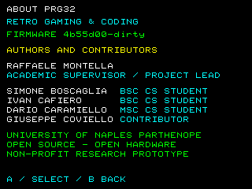
</p>

See [CONTRIBUTORS.md](CONTRIBUTORS.md) for contributor metadata suitable for academic submissions.

## Citation

For reports, theses, or coursework submissions, use the citation metadata in [CITATION.cff](CITATION.cff).
