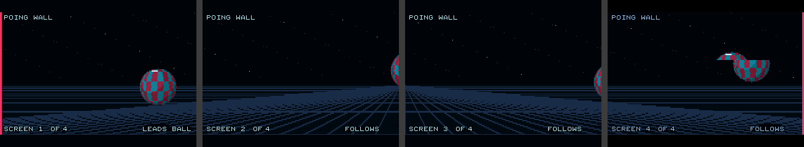

# Poing Wall: one ball across many PRG32 screens

Poing Wall turns every console in a room into one 320-pixel section of a single
horizontal wall. One ball bounces along the whole wall: it leaves one screen and
enters the next, whether those screens are QEMU windows, ESP32-C6 boards, or a
mix of both.

It is the visual integration test of the
[multiplayer protocol](../../docs/software/multiplayer_protocol.md), and a small
worked example of a distributed game with no game server. It is separate from
[Poing](../poing/README.md), whose frame cost is a performance reference.



## Running it

The firmware needs the address of a
[PRG32 Multiplayer Server](https://github.com/riscv-prg32/PRG32-Multiplayer-Server),
then each console needs the cartridge. Replace the address with your server's:

```bash
source "$HOME/esp-idf/export.sh"
python3 -m prg32 multiplayer set-url ws://192.168.1.10:8081
python3 -m prg32 qemu build
cartridges/poingwall/build.sh "$PWD" qemu
```

Start as many emulators as you like, each in its own terminal. Each one is an
independent console with its own identity:

```bash
python3 -m prg32 qemu run --instance 1 --no-audio
```

```bash
python3 -m prg32 esp32c6 upload cartridges/poingwall/dist/poingwall-qemu.prg32 \
  --port socket://127.0.0.1:5565 --command run --slot cart0
```

Instance `N` listens on port `5555 + 10 * N`. A board uses its own build,
`poingwall-esp32c6.prg32`, and overwrites the slot you choose.

Pressing **A** on any console sends the ball back the other way.

## What each console does

| Decision | Rule | Why they all agree |
|---|---|---|
| Order of the screens | Sort all player IDs | The same IDs sort the same way everywhere |
| Who moves the ball | The lowest ID among consoles that are ready | The same rule on the same IDs |
| Width of the wall | 320 pixels for each screen | Follows from the roster |
| What to draw | The part of the ball on this console's section | Follows from its place in the order |

Nobody sends the order of the screens or the name of the leader. See
[architecture](docs/architecture.md) for how the rules behave when consoles join
and leave.

## The snapshot

The server does not know what these fields mean. The signature `poing-wall-v2`
names this meaning, and must change if it changes.

| Field | Meaning |
|---|---|
| `x` | Ball position in whole pixels from the left end of the wall |
| `y` | Ball height in 1/16 pixels |
| `sprite` | Bits 0-7: horizontal velocity. Bits 8-15: vertical velocity. Signed, in 1/16 pixels per step |
| `flags` | Bit 0: ready to lead. Bit 1: is leading. Bits 8-15: screens this console can see |
| `input` | The controller, so a follower's A button can reach the leader |
| `frame` | Advances with every local update |

## Limits

- Nine screens: the firmware keeps eight peers.
- A console with no server reachable still runs, as a wall of one screen.
- The ball is not protected from a dishonest console. The protocol is meant for
  classrooms and trusted rooms.

## Testing

`tests/run.sh` drives the cartridge on a computer against a scripted room.
`tools/multiplayer_wall_test.py` runs real consoles against a real server; see
[testing the protocol](../../docs/software/multiplayer_protocol.md#testing).
