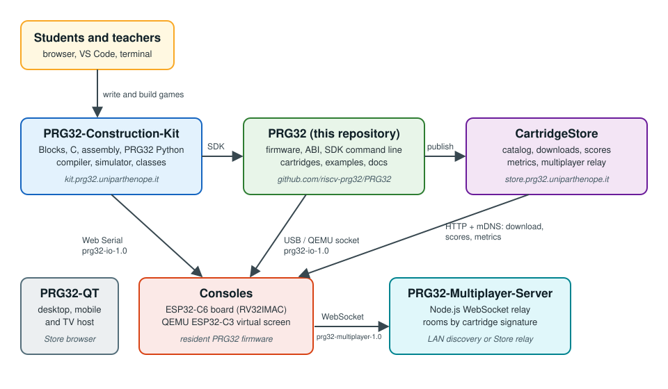

# The PRG32 Ecosystem

PRG32 is one of several public repositories in the
[riscv-prg32](https://github.com/riscv-prg32) organization. This page says what
each one is for and how they talk to each other. Protocol details stay in the
pages linked from the table; this page only maps them.

## Ready to go: the hosted Construction Kit

The quickest way to try PRG32 needs no installation: open
**[kit.prg32.uniparthenope.it](https://kit.prg32.uniparthenope.it)** in a
Chromium-based browser. You write a game with Blocks, C, RISC-V assembly, or
PRG32 Python, the kit compiles a real `.prg32` cartridge, and its simulator runs
it in the page. With a PRG32 board on the USB port, the kit's Deploy page sends
the cartridge to the board through Web Serial
([Web-to-USB deployment](software/web_usb_deployment.md)).

Install this repository when you want to build the firmware, flash a board, run
QEMU, or work from the command line ([Getting Started](usage/getting_started.md)).

## Repositories

| Repository | What it is | How PRG32 uses it |
|---|---|---|
| [PRG32](https://github.com/riscv-prg32/PRG32) (this repository) | Resident firmware for the ESP32-C6 and QEMU, the portable cartridge [ABI](software/abi.md), the `python3 -m prg32` SDK, in-tree cartridges, examples, labs, and hardware references | The reference implementation every other repository follows |
| [PRG32-Construction-Kit](https://github.com/riscv-prg32/PRG32-Construction-Kit) | Classroom web IDE (Flask, Blockly, Monaco, installable as a PWA): Blocks, C, assembly, and PRG32 Python projects, a browser simulator, sandboxed builds, and teacher class views. Hosted at [kit.prg32.uniparthenope.it](https://kit.prg32.uniparthenope.it) | Shares the PRG32 Python compiler ([alignment rules](software/python_language.md#keeping-the-sdk-and-the-kit-aligned)) and the browser `prg32-io-1.0` client |
| [CartridgeStore](https://github.com/riscv-prg32/CartridgeStore) | App-store-style catalog and classroom service hub (Flask, PWA): cartridge downloads per architecture, scores, frame metrics, a multiplayer relay, and mDNS discovery. Public instance at [store.prg32.uniparthenope.it](https://store.prg32.uniparthenope.it/) | The firmware setup menu browses and installs from it ([Cartridge Store guide](cartridge_store/cartridge_store.md), [consistency rules](agents/cartridge_store_consistency.md)) |
| [PRG32-Multiplayer-Server](https://github.com/riscv-prg32/PRG32-Multiplayer-Server) | Small Node.js WebSocket relay that groups consoles by cartridge signature and relays bounded player snapshots | Consoles find it on the local network or through the Store ([multiplayer protocol](software/multiplayer_protocol.md)) |
| [PRG32-QT](https://github.com/riscv-prg32/PRG32-QT) | Portable C++20 / Qt 6 host that runs `.prg32` cartridges on desktop, mobile, and TV systems | Implements the same ABI, audio engine, and a loopback `prg32-io-1.0` listener ([API notes](software/api.md#prg32-qt-optional-debugger-api)) |

Game cartridges also live in their own repositories in the organization; the
[README](../README.md#featured-games) shows a selection.

## Protocols between the parts

| Link | Protocol | Reference |
|---|---|---|
| SDK, Construction Kit, PRG32-QT to a console | `prg32-io-1.0` over native USB, Web Serial, or the QEMU socket | [Offline device protocol](software/usb_protocol.md) |
| Console to Cartridge Store | HTTP, discovered with mDNS `_prg32store._tcp` | [Cartridge Store guide](cartridge_store/cartridge_store.md), [Score API](cartridge_store/score_api.md) |
| Console to Multiplayer Server | WebSocket, `prg32-multiplayer-1.0` | [Multiplayer protocol](software/multiplayer_protocol.md) |
| Cartridge to firmware | ABI table, `PRG32_ABI_MAJOR` / hash checks | [ABI](software/abi.md) |

## Hardware

Build a console from the [bill of materials](hardware/where_to_buy.md), or see
[hardware availability](hardware/availability.md) for third-party boards that
may fit the PRG32 specification.
