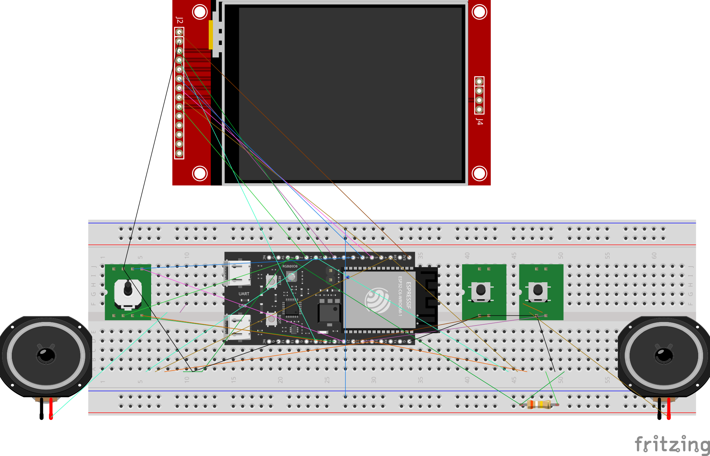

# PRG32 Hardware Documentation

Welcome to the PRG32 Hardware documentation. This guide serves as the central index and architectural reference for building physical PRG32 consoles using solderless breadboards, DIY stripboards, or the reference PCB design.

For PCB fabrication files and Fritzing designs, please see the [PCB Reference Design](../pcb/README.md).



*Breadboard prototype using the reference landscape layout and common ground distribution.*

---

> [!IMPORTANT]
> **Architectural Requirement: Single Source of Truth for Pin Setups**
> Individual component documentation files in this directory (`audio.md`, `joystick.md`, `ili9341.md`, `sdcard.md`, `rgb_led.md`, etc.) **must NEVER contain physical pin setups, GPIO numbers, or pinout tables**.
> All GPIO pin configurations, schematics, and wiring tables are maintained exclusively in the [**`profiles/`**](profiles/README.md) directory and their corresponding build fragment files in `profiles/sdkconfig.pins.*`.

## Component Hardware Guides

PRG32 hardware documentation is organized into modular guides covering each subsystem:

| Subsystem | Documentation Guide | Description |
|---|---|---|
| **Display** | [**ILI9341 SPI TFT Guide**](ili9341.md) | 2.8" SPI TFT (320x240 landscape), 3.3V logic, high-speed SPI wiring, and active-high backlight control. |
| **Audio** | [**Audio Hardware Guide**](audio.md) | MAX98357A I2S DAC/Amp, mono and stereo channel modes, SD/MODE 390 kΩ resistor divider, and speaker safety. |
| **Joysticks & Controls** | [**Joystick & Input Guide**](joystick.md) | 5-way digital navigation joystick (`breadboard1`), KY-023 2-axis analog thumbstick with continuous ADC (`breadboard2`), buttons A/B, and hardware shortcuts. |
| **RGB LED** | [**Onboard RGB LED Guide**](rgb_led.md) | WS2812 addressable LED driver API, pin allocation considerations, and status/visualizer integration. |
| **MicroSD Interface** | [**MicroSD Card Guide**](sdcard.md) | Shared SPI bus connection, reserved Chip Select line, and future storage support. |
| **Memory** | [**Memory Architecture Guide**](memory.md) | ESP32-C6 SRAM partitions (IRAM, DRAM, LP SRAM), cartridge RAM windows, and build/runtime memory profiling tools. |
| **Multiplayer / External** | [**External Controllers & Multiplayer**](external_controllers.md) | Local single-player architecture, Wi-Fi multi-console multiplayer, and input packet synchronization. |
| **Hardware Profiles** | [**Pin Profiles Directory**](profiles/README.md) | Complete comparison and wiring tables for [`breadboard1`](profiles/breadboard1.md) and [`breadboard2`](profiles/breadboard2.md). |
| **Bill of Materials** | [**Where to Buy & Sourcing Guide**](where_to_buy.md) | Central parts list, component specifications, and direct Amazon search links across 23 countries. |

---

## Breadboard Layout & Physical Assembly

In the reference breadboard build:
- The **ESP32-C6** sits horizontally across the central breadboard divider trench.
- Its two header rows occupy opposite terminal-strip halves, ensuring each pin has four accessible tie-points and preventing cross-row shorts.
- The **ILI9341 Display** sits above the MCU, facing the user in landscape orientation.
- The **Joystick and Action Buttons (A & B)** are positioned at the bottom edge for comfortable hand placement.
- The **MAX98357A Audio Amplifiers** flank the board on the left and right, routing directly to the speakers.

### Breadboard Power Distribution

> [!CAUTION]
> **DO NOT INTERCHANGE 3.3V AND 5V RAILS.**
> The analog joystick potentiometers, display logic, and ESP32-C6 GPIOs use **3.3V only**. Supplying 5V to the analog inputs or display pins will permanently damage the ESP32-C6 microcontroller.

| Breadboard Rail | Voltage | Connected Subsystems |
|---|---:|---|
| **Upper Blue Rail** | **GND** | ESP32-C6 GND, ILI9341 GND, joystick ground, button grounds |
| **Upper Red Rail** | **3.3V** | ESP32-C6 3V3, ILI9341 VCC, analog joystick potentiometer VCC |
| **Lower Blue Rail** | **GND** | Both MAX98357A GND pins (bridged to upper blue rail) |
| **Lower Red Rail** | **5V** | ESP32-C6 5V (VBUS) and both MAX98357A VIN pins |

### Assembly Steps

1. **Disconnect Power**: Disconnect USB cables and any external power sources before placing components.
2. **Mount the MCU**: Place the ESP32-C6 horizontally across the center trench. Verify that pin rows occupy distinct terminal strips.
3. **Bridge Ground Rails**: Install a jumper bridging the upper blue rail to the lower blue rail (e.g. at column 61) so the display, MCU, controls, and amplifiers share a unified ground plane.
4. **Wire 3.3V Logic**: Connect the upper red rail exclusively to ESP32-C6 3V3, display VCC, and (if using `breadboard2`) analog joystick potentiometer VCC.
5. **Wire 5V Audio**: Connect the lower red rail to ESP32-C6 5V / VBUS and the MAX98357A VIN pins.
6. **Wire Signals**: Connect signals according to the active hardware profile guide ([`breadboard1`](profiles/breadboard1.md) or [`breadboard2`](profiles/breadboard2.md)).

---

## Hardware Pin Profiles & Software Selection

PRG32 completely decouples physical GPIO numbers from Kconfig defaults. All pin configurations are maintained as modular profiles in `profiles/sdkconfig.pins.*`.

### Active Profiles

- **`breadboard1`**: First breadboard using the digital 5-way navigation joystick, reference display harness, and I2S audio. Full pinout and wiring tables are detailed in [`breadboard1.md`](profiles/breadboard1.md).
- **`pcb1`**: Soldered PCB with the digital 5-way joystick (P1 DOWN on GPIO13, the native USB D+ line), display, and I2S audio. Full pinout, schematic, and board layout are detailed in [`pcb1.md`](profiles/pcb1.md).
- **`breadboard2`**: Second breadboard using the KY-023 analog joystick with continuous ADC, updated display harness, reserved SD card CS line, and I2S audio. Full pinout and wiring tables are detailed in [`breadboard2.md`](profiles/breadboard2.md).

### Compiling for a Specific Profile

```bash
# List all available hardware profiles and their pin mappings
python3 -m prg32 esp32c6 pins

# Build specifying the hardware profile
python3 -m prg32 esp32c6 build --pin-profile breadboard1
python3 -m prg32 esp32c6 build --pin-profile breadboard2

# Build and flash directly to your board
python3 -m prg32 esp32c6 build --pin-profile breadboard2 && python3 -m prg32 esp32c6 flash
```

You can also choose the profile interactively in `idf.py menuconfig`:
`Component config` -> `PRG32 Framework` -> `PRG32 Board Configuration` -> `Hardware Pin Profile`.

---

## Hardware Troubleshooting & Verification

- **Terminal Continuity**: Ensure jumper wires connect to an unused hole in the **exact same vertical 5-hole group** as the target MCU pin. Never assume continuity across the center trench.
- **Midpoint Power Rail Breaks**: Some breadboards split power rails halfway along their length (marked by a physical break in the colored stripes). If present, install short jumper bridges across the midpoint split.
- **Pre-Power Verification**: Before inserting USB power, use a digital multimeter in continuity / resistance mode:
  1. Confirm zero resistance between the upper and lower blue GND rails.
  2. Confirm open circuit (infinite resistance) between the 3.3V red rail and GND.
  3. Confirm open circuit between the 5V red rail and GND.
  4. Confirm open circuit between the 3.3V rail and the 5V rail.
