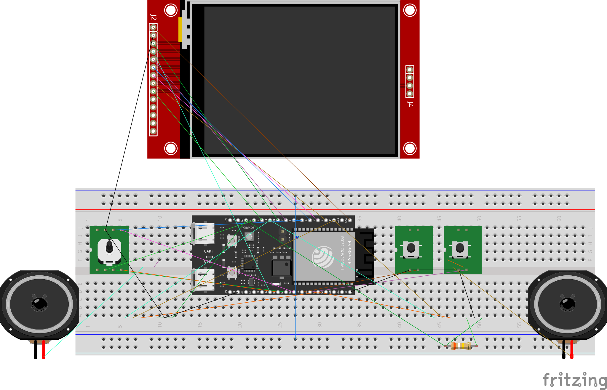

# PRG32 Hardware Pin Profile: Breadboard 1

This document specifies the pinout and wiring for the **`breadboard1`** hardware profile (`profiles/sdkconfig.pins.breadboard1`): a breadboard build with a digital 5-way navigation joystick, four action buttons (A, B, C, D), no L and R bumpers, and MAX98357A I2S audio.



*Breadboard 1 using discrete 5-way digital joystick switches and an ILI9341 display. Edited SVG of the earlier `breadboard1` wiring (LCD D/C on GPIO8, two buttons): it does not yet show the pins below. Follow the tables, not the drawn wires.*

> [!WARNING]
> - GPIO9 is an ESP32-C6 strapping pin and is wired to the DevKitC-1 **BOOT**
>   button. This profile puts the display CS on it; see
>   [Strapping pin GPIO9](#strapping-pin-gpio9).
> - GPIO12/GPIO13 are the native USB D-/D+ pair used for uploads and the
>   device protocol. Never wire anything to them.
> - GPIO8 carries the DevKitC-1 onboard WS2812 data input. This profile leaves
>   it unused.

## Overview

- **Architecture Target**: ESP32-C6 (ESP32-C6-DevKitC-1 development board)
- **Display**: ILI9341 2.8" SPI TFT (320x240) with CS on GPIO9, DC on GPIO10, and RST wired to the ESP32-C6 EN (`RST`) header pin
- **Input Type**: Digital 5-way navigation joystick (discrete GPIO switches with pull-ups)
- **Action Buttons**: Separate pushbuttons for A, B, C, and D; the joystick center press is START/SELECT
- **Bumper Buttons**: None (`CONFIG_PRG32_ENABLE_LR_BUTTONS=n`)
- **Audio**: MAX98357A I2S DAC / amplifier (Mono or Stereo) with LRC/WS on GPIO15
- **RGB LED**: Off (`CONFIG_PRG32_PIN_RGB_LED=-1`, `CONFIG_PRG32_PIN_SHARED_RGB_LED=-1`); GPIO8 is free, so the DevKitC-1 onboard WS2812 can be enabled
- **Configuration Profile**: `profiles/sdkconfig.pins.breadboard1`

## Pinout and Wiring

### Display (ILI9341 SPI TFT)

| ESP32-C6 GPIO | ILI9341 Signal | Description |
|---|---|---|
| 3V3 | VCC | 3.3V Logic Supply |
| GND | GND | Ground |
| GPIO7 | MOSI | SPI Master Out Slave In |
| GPIO2 | MISO / DO | SPI Master In Slave Out; used to read the display ID at boot |
| GPIO6 | SCLK | SPI Serial Clock |
| GPIO9 | CS | Display Chip Select (active-low); strapping pin, see below |
| GPIO10 | DC | Data / Command Select |
| EN (`RST` header pin) | RST | Hardware Reset; no GPIO (`CONFIG_PRG32_PIN_LCD_RST=-1`), see [Display Reset Line](#display-reset-line) |
| GPIO5 | BL / LED | Backlight control (active-high) |

#### Display Reset Line

The ILI9341 RST pin is wired to the ESP32-C6-DevKitC-1 header pin labelled
`RST`, which is the chip enable (EN) input. No GPIO drives the display reset.

- **Hardware reset with the chip.** EN goes low at power-up, when the board's
  RST button is pressed, and when the USB-UART bridge auto-resets the board
  for flashing. While EN is low, the ESP32-C6 is off and the display is held
  in reset; when EN rises, both start together. The ILI9341 needs about 120 ms
  after a reset before it accepts setup commands, and the ESP32-C6 boot alone
  takes longer, so the timing is met.
- **Software restarts.** `esp_restart()`, panics, and watchdog resets happen
  inside the chip and do not drive EN, so the display gets no hardware reset.
  Every boot sends the ILI9341 software reset command before configuring the
  controller (see the [ILI9341 notes](../ili9341.md#reset-line)).
- **Electrical load.** The display RST input only senses voltage, so it does
  not hold EN low and the ESP32-C6 boots normally.

> [!WARNING]
> Never wire a GPIO to EN, and never connect the display RST to both EN and a
> GPIO. When a GPIO pulls EN low the ESP32-C6 switches itself off and the GPIO
> stops driving, and it fights the RST button and the auto-reset circuit.

#### Strapping Pin GPIO9

If GPIO9 is low at reset, the ESP32-C6 starts the ROM download mode instead of
PRG32. The display CS input never pulls the pin low, and the boot pull-up keeps
the display deselected until the driver starts. Pressing BOOT while PRG32 runs
only holds CS low and may glitch the screen briefly. Never wire a button to
GPIO9.

### Controls: Digital 5-Way Joystick & Buttons

The firmware enables internal pull-ups on every input. Direction and button presses short the pin to GND.

| ESP32-C6 GPIO | Input Signal | Description |
|---|---|---|
| GPIO22 | P1 LEFT | Left direction, switch to GND |
| GPIO21 | P1 RIGHT | Right direction, switch to GND |
| GPIO0 | P1 UP | Up direction, switch to GND |
| GPIO1 | P1 DOWN | Down direction, switch to GND |
| GPIO20 | P1 START / SELECT | Joystick center press, switch to GND |
| GPIO18 | P1 A | Action button A, switch to GND |
| GPIO19 | P1 B | Action button B, switch to GND |
| GPIO11 | P1 C | Action button C, switch to GND |
| GPIO3 | P1 D | Action button D, switch to GND |
| Not wired | P1 L / P1 R | No bumpers: `CONFIG_PRG32_ENABLE_LR_BUTTONS=n`, so `PRG32_BTN_L` and `PRG32_BTN_R` always read as released from local buttons (see [bumpers](../joystick.md#action-buttons-a-b-c-d-and-bumpers-l-r)) |

### Audio (I2S MAX98357A)

#### Mono Configuration
| ESP32-C6 GPIO | MAX98357A Signal | Description |
|---|---|---|
| 3V3 or 5V | VIN | Power supply |
| GND | GND | Ground |
| GPIO4 | BCLK | I2S Bit Clock |
| GPIO15 | LRC / WS | I2S Word Select / Left-Right Clock |
| GPIO23 | DIN | I2S Serial Data |
| Not wired (`-1`) | SD / MODE | Optional shutdown / mode |

#### Stereo Configuration
| ESP32-C6 GPIO | Left MAX98357A | Right MAX98357A | Description |
|---|---|---|---|
| 3V3 or 5V | VIN | VIN | Power supply |
| GND | GND | GND | Common ground |
| GPIO4 | BCLK | BCLK | Shared I2S Bit Clock |
| GPIO15 | LRC / WS | LRC / WS | Shared I2S Word Select |
| GPIO23 | DIN | DIN | Shared I2S Data |
| Same as VIN (> 1.4V) | SD / MODE | - | Left channel select |
| 0.77V to 1.4V (390 kΩ to VIN) | - | SD / MODE | Right channel select |

### Onboard RGB LED

| ESP32-C6 GPIO | Setting | Description |
|---|---|---|
| GPIO8 | (hardwired on the DevKitC-1) | Onboard WS2812 data input; no other signal uses GPIO8 in this profile |
| Not wired (`-1`) | `CONFIG_PRG32_PIN_RGB_LED` | Set to `8` to enable the LED API and the audio visualizer |
| Not set (`-1`) | `CONFIG_PRG32_PIN_SHARED_RGB_LED` | Not needed: the LED does not share a pin with the display (see [Shared Boot Indication](../rgb_led.md#shared-boot-indication)) |

### GPIO Usage Summary

| GPIO | Function | GPIO | Function |
|---|---|---|---|
| 0 | P1 UP | 11 | P1 C |
| 1 | P1 DOWN | 12 | Free (native USB D-, do not use) |
| 2 | LCD MISO | 13 | Free (native USB D+, do not use) |
| 3 | P1 D | 15 | I2S LRC / WS |
| 4 | I2S BCLK | 18 | P1 A |
| 5 | LCD backlight | 19 | P1 B |
| 6 | LCD SCLK | 20 | P1 START / SELECT |
| 7 | LCD MOSI | 21 | P1 RIGHT |
| 8 | Free (onboard WS2812) | 22 | P1 LEFT |
| 9 | LCD CS (strapping pin) | 23 | I2S DIN |
| 10 | LCD DC | | |

GPIO16 and GPIO17 are the DevKitC-1 UART0 TX/RX lines used by the UART bridge
port.

## Breadboard Power Distribution & Assembly

Use the power buses on the solderless breadboard as follows. Do not interchange the 3V3 and 5V rails:

| Breadboard bus | Voltage | Connections |
|---|---:|---|
| Upper blue bus | GND | ESP32-C6 GND, ILI9341 GND, joystick/button grounds |
| Upper red bus | 3V3 | ESP32-C6 3V3 and ILI9341 VCC |
| Lower blue bus | GND | Both MAX98357A GND pins |
| Lower red bus | 5V | ESP32-C6 5V and both MAX98357A VIN pins |

### Assembly Steps

1. Disconnect USB and all other power sources.
2. Place the ESP32-C6 horizontally across the center trench. Confirm that each header row is in a different five-hole terminal-strip half.
3. Wire the two ground buses and the column-61 ground bridge first. Install the black jumper at column 61 between the upper and lower blue buses so the display, controls, ESP32-C6, and amplifiers share one ground reference. If the breadboard has a midpoint break in either bus, add a jumper across each used split as well. The upper red 3V3 bus and lower red 5V bus must remain separate.
4. Wire ESP32-C6 3V3 and the display only to the upper red bus.
5. Wire ESP32-C6 5V and both MAX98357A VIN pins only to the lower red bus.
6. Connect one 4-8 ohm speaker to the MAX98357A speaker `+` and `-` outputs.

## Profile File

`profiles/sdkconfig.pins.breadboard1` sets:

```text
CONFIG_PRG32_PIN_PROFILE_BREADBOARD1=y
CONFIG_PRG32_PINS_CONFIGURED=y
CONFIG_PRG32_PIN_PROFILE_NAME="breadboard1"

CONFIG_PRG32_PIN_LCD_MOSI=7
CONFIG_PRG32_PIN_LCD_MISO=2
CONFIG_PRG32_PIN_LCD_SCLK=6
CONFIG_PRG32_PIN_LCD_CS=9
CONFIG_PRG32_PIN_LCD_DC=10
CONFIG_PRG32_PIN_LCD_RST=-1
CONFIG_PRG32_PIN_LCD_BL=5

CONFIG_PRG32_JOYSTICK_DIGITAL=y
CONFIG_PRG32_PIN_BTN_UP=0
CONFIG_PRG32_PIN_BTN_DOWN=1
CONFIG_PRG32_PIN_BTN_LEFT=22
CONFIG_PRG32_PIN_BTN_RIGHT=21
CONFIG_PRG32_PIN_BTN_START=20
CONFIG_PRG32_PIN_BTN_A=18
CONFIG_PRG32_PIN_BTN_B=19
CONFIG_PRG32_PIN_BTN_C=11
CONFIG_PRG32_PIN_BTN_D=3
CONFIG_PRG32_ENABLE_LR_BUTTONS=n
CONFIG_PRG32_PIN_SETUP=-1

CONFIG_PRG32_AUDIO_I2S_BCLK_GPIO=4
CONFIG_PRG32_AUDIO_I2S_LRCLK_GPIO=15
CONFIG_PRG32_AUDIO_I2S_DATA_GPIO=23
CONFIG_PRG32_AUDIO_I2S_SD_GPIO=-1

CONFIG_PRG32_PIN_BUZZER=-1
CONFIG_PRG32_PIN_RGB_LED=-1
CONFIG_PRG32_PIN_SHARED_RGB_LED=-1
```

With `CONFIG_PRG32_ENABLE_LR_BUTTONS=n`, menuconfig hides
`CONFIG_PRG32_PIN_BTN_L` and `CONFIG_PRG32_PIN_BTN_R` and the firmware uses
`-1` for both.

## Software & Build Selection

To compile physical firmware using this profile:

```bash
# PRG32 CLI
python3 -m prg32 esp32c6 build --pin-profile breadboard1

# Flash directly
python3 -m prg32 esp32c6 build --pin-profile breadboard1 && python3 -m prg32 esp32c6 flash

# Direct ESP-IDF build
idf.py -D SDKCONFIG_DEFAULTS="profiles/sdkconfig.defaults;profiles/sdkconfig.defaults.esp32c6;profiles/sdkconfig.pins.breadboard1" build
```

You can also select `breadboard1` interactively in `idf.py menuconfig`:
`Component config` -> `PRG32 Framework` -> `PRG32 Board Configuration` -> `Hardware Pin Profile` -> `breadboard1 (First Breadboard)`.

## History

Until 2026-11 `breadboard1` put LCD D/C on GPIO8, where the DevKitC-1 WS2812
also sits, and used that LED only as a shared boot indicator
(`CONFIG_PRG32_PIN_SHARED_RGB_LED=8`). The display now uses the `breadboard2`
harness (CS on GPIO9, DC on GPIO10, RST on EN), so the shared LED setting was
removed. The soldered [`pcb1`](pcb1.md) board keeps the earlier display pins
and the shared LED.

## Related Documentation

- [Hardware Pin Profiles](README.md): all profiles and how to document one.
- [Joystick & Input Guide](../joystick.md): digital joystick behavior, buttons, and bumpers.
- [RGB LED](../rgb_led.md): LED driver and the shared boot indication.
- [ILI9341 Display](../ili9341.md): display driver and reset behavior.
- [Audio](../audio.md): MAX98357A mono and stereo modes.
