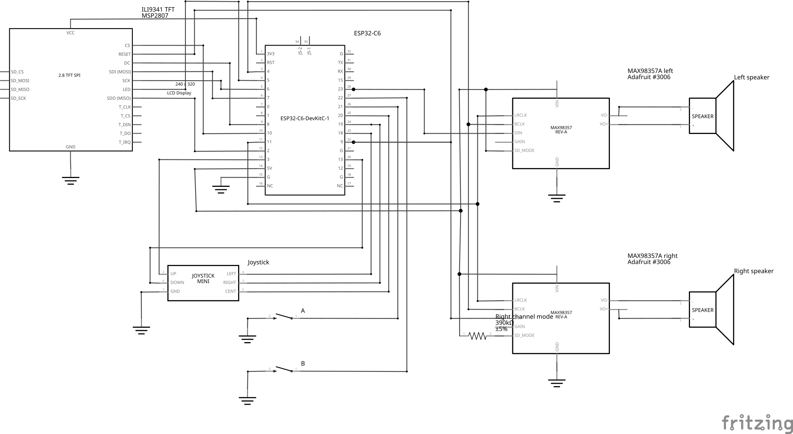

# PRG32 Hardware Pin Profile: PCB 1

This document specifies the pinout, schematic, and wiring for the **`pcb1`**
hardware profile (`profiles/sdkconfig.pins.pcb1`). `pcb1` describes the
soldered PRG32 printed circuit board: an ESP32-C6-DevKitC-1 carrying an
ILI9341 display, a digital 5-way joystick, A and B buttons, and MAX98357A I2S
audio, with P1 DOWN wired to GPIO13.



*Electrical schematic of PCB 1. This is the Fritzing schematic export from
before the 2026-10-28 layout review, which draws exactly this pinout. The
Fritzing project in the repository has since moved to the `breadboard1` pins
(see [layout status](../pcb/README.md#layout-status)).*

> [!WARNING]
> GPIO13 is the ESP32-C6 native USB D+ line. Configuring it as a button input
> takes the pin away from the USB Serial/JTAG peripheral once the firmware
> starts, so USB uploads through the
> [device protocol](../../software/usb_protocol.md) and the USB console fail on
> the DevKitC-1 **USB** port. Use the **UART** (USB-to-UART bridge) port for
> flashing, monitoring, and cartridge uploads.

## Overview

- **Architecture Target**: ESP32-C6 (ESP32-C6-DevKitC-1 development board)
- **Board**: Soldered PCB, 210 x 75 mm, landscape
- **Display**: ILI9341 2.8" SPI TFT (320x240) with CS on GPIO10, DC on GPIO8, and RST on GPIO9
- **Input Type**: Digital 5-way navigation joystick (discrete GPIO switches with pull-ups), DOWN on GPIO13
- **Action Buttons**: Separate pushbuttons for A and B; the joystick center press is START/SELECT
- **Audio**: MAX98357A I2S DAC / amplifier with LRC/WS on GPIO11; the board has positions for stereo, the firmware defaults to mono
- **RGB LED**: DevKitC-1 onboard WS2812 shared with LCD D/C on GPIO8, boot indication only (`CONFIG_PRG32_PIN_SHARED_RGB_LED=8`, `CONFIG_PRG32_PIN_RGB_LED=-1`)
- **Configuration Profile**: `profiles/sdkconfig.pins.pcb1`

## Board Layout

Controls face the player on the front; compute and audio are on the rear.

| Side | Components, left to right |
|---|---|
| Front | Digital joystick, ILI9341 display (landscape), A button, B button |
| Rear (viewed from the rear) | Left speaker, left MAX98357A, ESP32-C6-DevKitC-1, right MAX98357A, right speaker |

The 390 kΩ right-channel mode resistor (1206 footprint) sits beside the right
MAX98357A on the rear. Keep the antenna end of the ESP32-C6 module clear of
metal in any enclosure.

## Pinout and Wiring

### Display (ILI9341 SPI TFT)

| ESP32-C6 GPIO | ILI9341 Signal | Description |
|---|---|---|
| 3V3 | VCC | 3.3V Logic Supply |
| GND | GND | Ground |
| GPIO7 | MOSI / SDI | SPI Master Out Slave In |
| GPIO2 | MISO / SDO | SPI Master In Slave Out |
| GPIO6 | SCLK / SCK | SPI Serial Clock |
| GPIO10 | CS | Display Chip Select (active-low) |
| GPIO8 | DC | Data / Command Select (shared with the DevKitC-1 onboard WS2812 data input, see [Onboard RGB LED](#onboard-rgb-led)) |
| GPIO9 | RST / RESET | Hardware Reset (active-low) |
| GPIO5 | BL / LED | Backlight control (active-high) |

### Controls: Digital 5-Way Joystick & Buttons

The firmware enables internal pull-ups on every input. Direction and button
presses short the pin to GND; no external pull-up resistors are needed.

| ESP32-C6 GPIO | Input Signal | Description |
|---|---|---|
| GPIO18 | P1 LEFT | Left direction, switch to GND |
| GPIO19 | P1 RIGHT | Right direction, switch to GND |
| GPIO3 | P1 UP | Up direction, switch to GND |
| GPIO13 | P1 DOWN | Down direction, switch to GND (native USB D+, see the warning above) |
| GPIO20 | P1 START / SELECT | Joystick center press, switch to GND |
| GPIO21 | P1 A | A button, switch to GND |
| GPIO22 | P1 B | B button, switch to GND |
| Not wired (`-1`) | SETUP | No dedicated setup button; hold A + B at boot instead |

Firmware shortcuts on this board:

| Button Combination | Timing | Action |
|---|---|---|
| A + B (hold) | During boot / power-on | Enter Setup Mode |
| A + B + DOWN (hold) | While a cartridge runs | Reboot to the resident firmware |

### Audio (I2S MAX98357A)

#### Mono Configuration (firmware default)

| ESP32-C6 GPIO | MAX98357A Signal | Description |
|---|---|---|
| 5V | VIN | Power supply |
| GND | GND | Ground |
| GPIO4 | BCLK | I2S Bit Clock |
| GPIO11 | LRC / WS | I2S Word Select / Left-Right Clock |
| GPIO23 | DIN | I2S Serial Data |
| Not wired (`-1`) | SD / MODE | Optional shutdown / mode |

#### Stereo Configuration

| ESP32-C6 GPIO | Left MAX98357A | Right MAX98357A | Description |
|---|---|---|---|
| 5V | VIN | VIN | Power supply |
| GND | GND | GND | Common ground |
| GPIO4 | BCLK | BCLK | Shared I2S Bit Clock |
| GPIO11 | LRC / WS | LRC / WS | Shared I2S Word Select |
| GPIO23 | DIN | DIN | Shared I2S Data |
| Same as VIN (> 1.4V) | SD / MODE | - | Left channel select |
| 0.77V to 1.4V (390 kΩ to VIN) | - | SD / MODE | Right channel select |

The firmware is mono by default (`CONFIG_PRG32_AUDIO_MODE_MONO=y`), which
matches a board with one amplifier fitted. A board with both amplifiers needs
`CONFIG_PRG32_AUDIO_MODE_STEREO=y` before the firmware is built. Each
MAX98357A drives one 4-8 Ω speaker between its `+` and `-` outputs; never
connect an output to ground, headphones, or a line input.

### Onboard RGB LED

| ESP32-C6 GPIO | Setting | Description |
|---|---|---|
| GPIO8 | Shared RGB LED (`CONFIG_PRG32_PIN_SHARED_RGB_LED=8`) | The DevKitC-1 WS2812 data input shares GPIO8 with LCD D/C; the firmware uses it only for the boot flash and the off frame after each display update |
| Not wired (`-1`) | `CONFIG_PRG32_PIN_RGB_LED` | RGB LED driver and visualizer disabled |

Because display traffic on GPIO8 also reaches the WS2812, the onboard LED can
still flicker while the screen updates. This is expected and harmless. See
[Shared Boot Indication](../rgb_led.md#shared-boot-indication) for what the
two LED settings do.

### GPIO Usage Summary

| GPIO | Function | GPIO | Function |
|---|---|---|---|
| 0 | Free | 11 | I2S LRC / WS |
| 1 | Free | 12 | Free (native USB D-) |
| 2 | LCD MISO | 13 | P1 DOWN (native USB D+) |
| 3 | P1 UP | 15 | Free |
| 4 | I2S BCLK | 18 | P1 LEFT |
| 5 | LCD backlight | 19 | P1 RIGHT |
| 6 | LCD SCLK | 20 | P1 START / SELECT |
| 7 | LCD MOSI | 21 | P1 A |
| 8 | LCD DC (+ onboard WS2812) | 22 | P1 B |
| 9 | LCD RST | 23 | I2S DIN |
| 10 | LCD CS | | |

GPIO16 and GPIO17 are the DevKitC-1 UART0 TX/RX lines used by the UART bridge
port.

## Power Distribution

The DevKitC-1 is powered from its USB connector and feeds the board through
its header pins:

| Net | Voltage | Connections |
|---|---:|---|
| GND | 0V | ESP32-C6 GND, ILI9341 GND, joystick and button commons, MAX98357A GND |
| 3V3 | 3.3V | ESP32-C6 3V3 and ILI9341 VCC |
| 5V | 5V | ESP32-C6 5V and MAX98357A VIN |

Never connect the 3V3 and 5V nets. With two 4 Ω speakers at high volume, peak
audio current can exceed 1 A, so use a USB port or supply that delivers at
least 1.5 A.

### Checks Before Power-On

With USB disconnected, use a multimeter in continuity / resistance mode:

1. Confirm open circuit between 3V3 and GND.
2. Confirm open circuit between 5V and GND.
3. Confirm open circuit between 3V3 and 5V.
4. Confirm continuity between the GND pins of the DevKitC-1, display, and amplifiers.

## Profile File

`profiles/sdkconfig.pins.pcb1` sets:

```text
CONFIG_PRG32_PIN_PROFILE_PCB1=y
CONFIG_PRG32_PINS_CONFIGURED=y
CONFIG_PRG32_PIN_PROFILE_NAME="pcb1"

CONFIG_PRG32_PIN_LCD_MOSI=7
CONFIG_PRG32_PIN_LCD_MISO=2
CONFIG_PRG32_PIN_LCD_SCLK=6
CONFIG_PRG32_PIN_LCD_CS=10
CONFIG_PRG32_PIN_LCD_DC=8
CONFIG_PRG32_PIN_LCD_RST=9
CONFIG_PRG32_PIN_LCD_BL=5

CONFIG_PRG32_PIN_BTN_UP=3
CONFIG_PRG32_PIN_BTN_DOWN=13
CONFIG_PRG32_PIN_BTN_LEFT=18
CONFIG_PRG32_PIN_BTN_RIGHT=19
CONFIG_PRG32_PIN_BTN_START=20
CONFIG_PRG32_PIN_BTN_A=21
CONFIG_PRG32_PIN_BTN_B=22
CONFIG_PRG32_PIN_SETUP=-1

CONFIG_PRG32_AUDIO_I2S_BCLK_GPIO=4
CONFIG_PRG32_AUDIO_I2S_LRCLK_GPIO=11
CONFIG_PRG32_AUDIO_I2S_DATA_GPIO=23
CONFIG_PRG32_AUDIO_I2S_SD_GPIO=-1

CONFIG_PRG32_PIN_BUZZER=-1
CONFIG_PRG32_PIN_RGB_LED=-1
CONFIG_PRG32_PIN_SHARED_RGB_LED=8
```

Options the file does not set keep their Kconfig defaults, such as the digital
joystick (`CONFIG_PRG32_JOYSTICK_DIGITAL=y`).

## Software & Build Selection

```bash
# PRG32 CLI
python3 -m prg32 esp32c6 build --pin-profile pcb1

# Direct ESP-IDF build
idf.py -D SDKCONFIG_DEFAULTS="profiles/sdkconfig.defaults;profiles/sdkconfig.defaults.esp32c6;profiles/sdkconfig.pins.pcb1" build
```

Flash through the DevKitC-1 **UART** port (see the warning at the top).

In `idf.py menuconfig` choose `Component config` -> `PRG32 Framework` ->
`PRG32 Board Configuration` -> `Hardware Pin Profile` ->
`pcb1 (Soldered PCB, DOWN on GPIO13)`.

## History

`pcb1` keeps the first breadboard pinout as it was when the board was drawn.
The [`breadboard1`](breadboard1.md) profile later moved P1 DOWN from GPIO13 to
GPIO0 to free the native USB pair (commit `b089e1e`) and added the shared RGB
LED boot indication on GPIO8 (commit `c327403`). `pcb1` later adopted the same
shared RGB LED setting, which changes no wiring. Use `pcb1` only for hardware
wired with DOWN on GPIO13; new breadboard builds use `breadboard1`.

## Related Documentation

- [Hardware Pin Profiles](README.md): all profiles and how to document one.
- [PCB Reference Design](../pcb/README.md): Fritzing project and layout status.
- [Joystick & Input](../joystick.md), [ILI9341 Display](../ili9341.md),
  [Audio Hardware](../audio.md), [RGB LED](../rgb_led.md): component behavior.
